# OpenFGA + RAG - Diagrams and Data Design

All diagrams from the capacity test, plus how data is stored in the vector DB,
pre-filtering vs post-filtering, and why we retrieve more chunks than we need.
Commands and test results are in [RUNBOOK.md](RUNBOOK.md).

---

## 0. Background: OpenFGA and Google Zanzibar

### 0.1 Links

| What | Link |
|---|---|
| OpenFGA source code (GitHub) | https://github.com/openfga/openfga |
| OpenFGA documentation | https://openfga.dev/docs |
| OpenFGA Playground / modeling | https://play.fga.dev |
| Zanzibar paper (Google, USENIX ATC 2019) | https://research.google/pubs/zanzibar-googles-consistent-global-authorization-system/ |
| Zanzibar paper (USENIX page + PDF) | https://www.usenix.org/conference/atc19/presentation/pang |

### 0.2 What is Zanzibar?

**"Zanzibar: Google's Consistent, Global Authorization System"** is the paper where Google describes the
single permission system behind its products (Drive, Calendar, Cloud, Photos, YouTube, Maps, ...).

Numbers reported in the paper:
- trillions of permission tuples stored
- millions of authorization checks per second
- p95 latency under 10 ms
- 99.999% availability over 3 years

**OpenFGA** is an open-source implementation of the Zanzibar ideas, started by Auth0/Okta and now a
CNCF (Cloud Native Computing Foundation) project. It is what we use in this lab.

### 0.3 Zanzibar ideas used in OpenFGA

| Zanzibar idea | Meaning | In our model |
|---|---|---|
| **Relation tuples** | every permission is one row: `object#relation@user` | `folder:f7#viewer@group:g7#member` |
| **Namespace / authorization model** | rules that say how relations combine | `document.viewer = direct viewer OR viewer from parent folder` |
| **Usersets** | a group of users referenced as one subject | `group:g7#member` |
| **Tuple-to-userset (inheritance)** | permissions flow down a hierarchy | document inherits `viewer` from its folder |
| **Check / ListObjects / Read APIs** | ask "is X allowed?", "what can X see?", "what tuples exist?" | batch-check, list-objects, read |
| **Consistency tokens ("zookies")** | avoid the "new enemy" problem (seeing content right after access was removed) | OpenFGA consistency options (`MINIMIZE_LATENCY` / `HIGHER_CONSISTENCY`) |

### 0.4 Why this approach is good

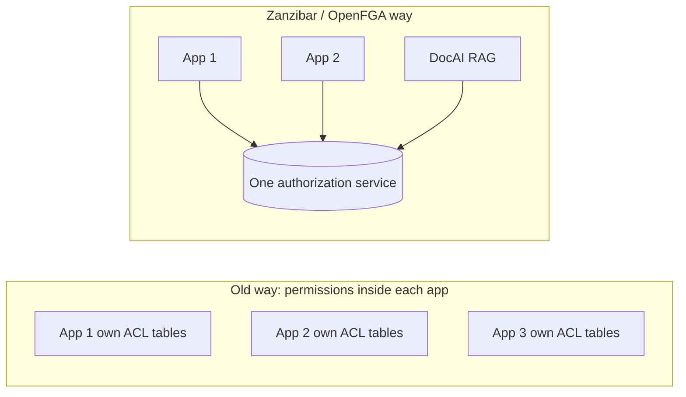

| Benefit | Why it matters for DocAI |
|---|---|
| **One source of truth** | all apps (DocAI, upload service, admin UI) ask the same service |
| **Fine-grained** | per user, per group, per folder, per document - not just "admin / user" roles |
| **Hierarchies built in** | give access to a folder once, all its documents follow |
| **Rules as a model, not code** | change who-can-see-what by editing the model, not every app |
| **Auditable** | every permission is an explicit tuple, with a changelog |
| **Proven design** | same ideas Google uses at massive scale |

### 0.5 How it scales

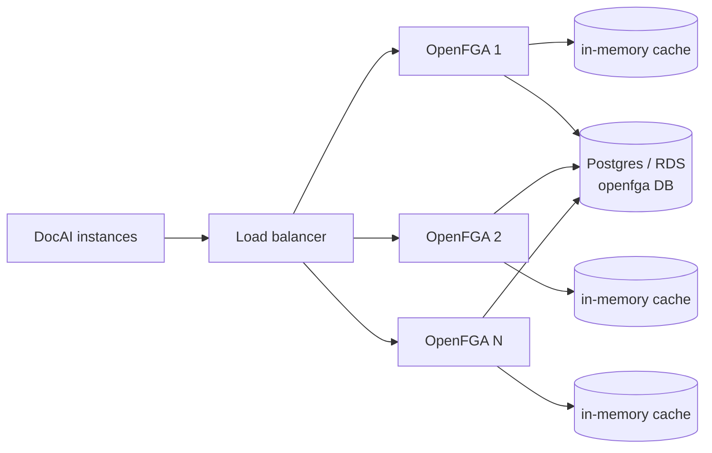

| Scaling lever | How |
|---|---|
| **Stateless servers** | OpenFGA keeps no state itself, so add more instances behind a load balancer (horizontal scaling) |
| **More CPU per instance** | our test: throughput grew with cores (2 -> 3 cores = more checks/s) |
| **Caching** | check-query cache and iterator cache keep repeated sub-results in memory |
| **Batch APIs** | batch-check answers up to 50 checks in one request |
| **Database** | Postgres/MySQL; scale with a bigger RDS instance, connection tuning, read replicas |
| **Good model + app design** | check at folder level, pre-filter, cache per user - the biggest win in our test (7.5x) |

What we measured in this lab (one instance, 3 cores, RDS, 200k documents):
- per-document checks: ~15 questions/s
- folder-level checks: **~113 questions/s, p50 ~106 ms, 0 errors** - and OpenFGA was only ~22% busy
  (the test script was the limit), so one instance can do more.

Google runs Zanzibar on its own global infrastructure (Spanner). OpenFGA is a smaller-scale implementation,
so measure with your own data (that is what this lab is for) instead of assuming Google's numbers.

---

## 1. Permission hierarchy

### 1.1 Building blocks (the model)

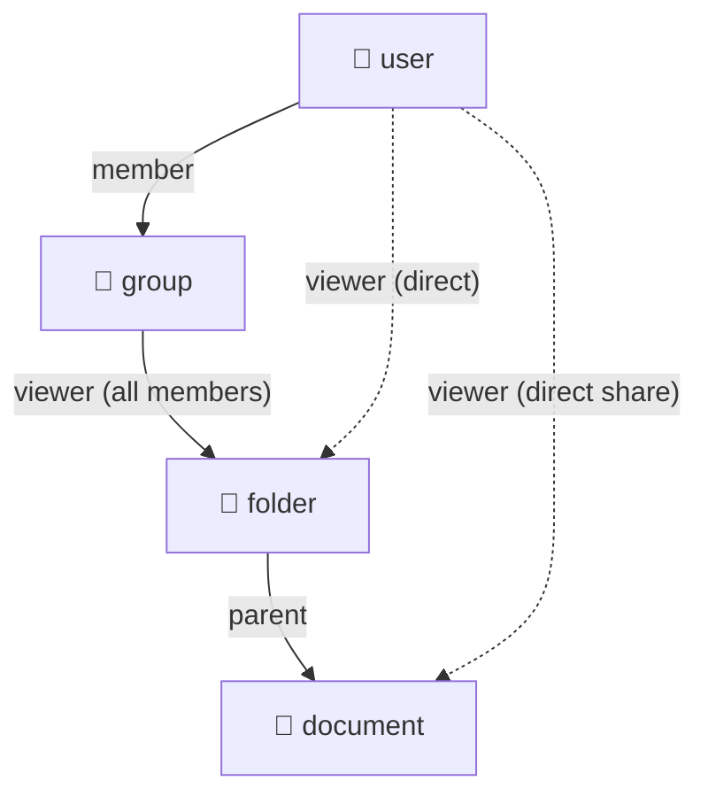

Users join groups, groups get access to folders, folders contain documents.
Dotted lines are shortcuts: access can also be given to one user directly.

### 1.2 Example with test data

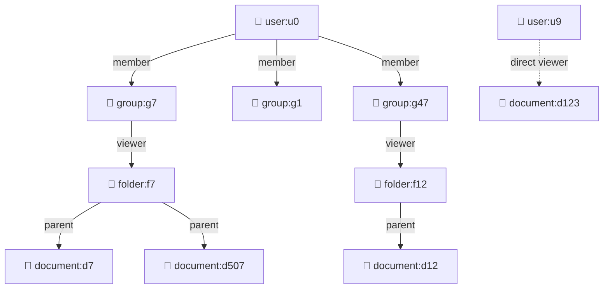

- u0 is in g7, g1, g47.
- g7 can view f7 -> u0 can view **d7, d507**.
- g47 can view f12 -> u0 can view **d12**.
- d123 is shared only with u9 -> u0 **cannot** view it.

### 1.3 Office analogy

| Tuple | Office meaning |
|---|---|
| `folder:f7 parent document:d507` | this paper is in this cabinet |
| `user:u9 viewer document:d123` | this paper was handed to this person personally |
| `group:g3#member viewer folder:f7` | this team has the key to this cabinet |
| `user:u5 member group:g3` | this person is in this team |

---

## 2. How OpenFGA answers one check

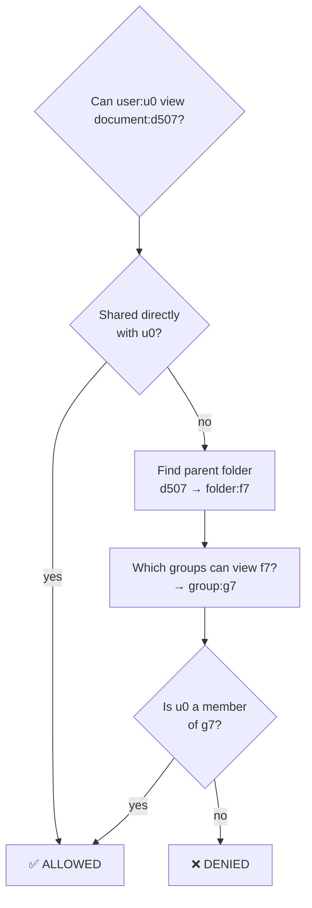

A **denied** answer is the most work: OpenFGA must try every path before saying no.
In the test, 94% of checks were denied.

---

## 3. Per-document vs per-folder checks

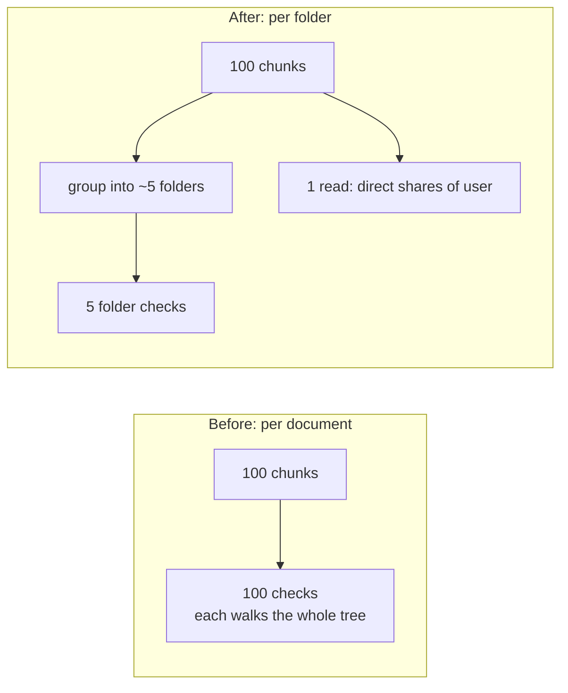

Result on the same machine (3 cores): **15 -> 113 questions/s**, p50 **902 ms -> 106 ms**, errors **2,920 -> 0**.

---

## 4. Test environment

### 4.1 Architecture

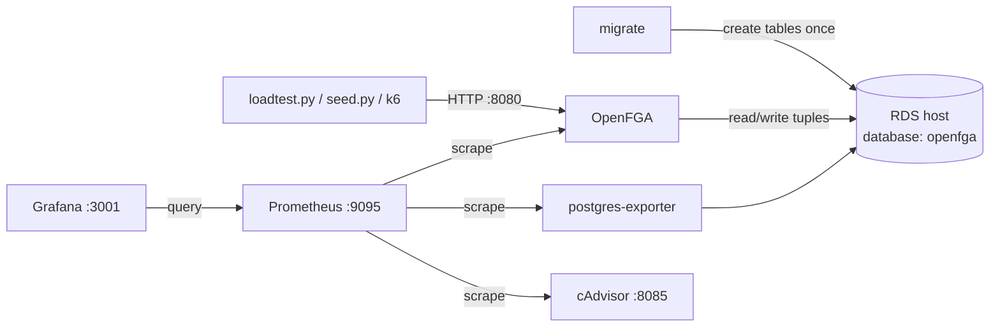

### 4.2 What `--concurrency` means

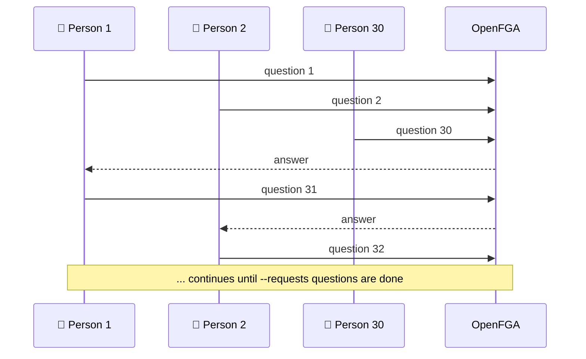

`--concurrency 30` = 30 people asking at the same time, each waits for the answer and asks again.
`--requests 5000` = stop after 5,000 questions in total.

---

## 5. How data is stored

### 5.1 Who stores what

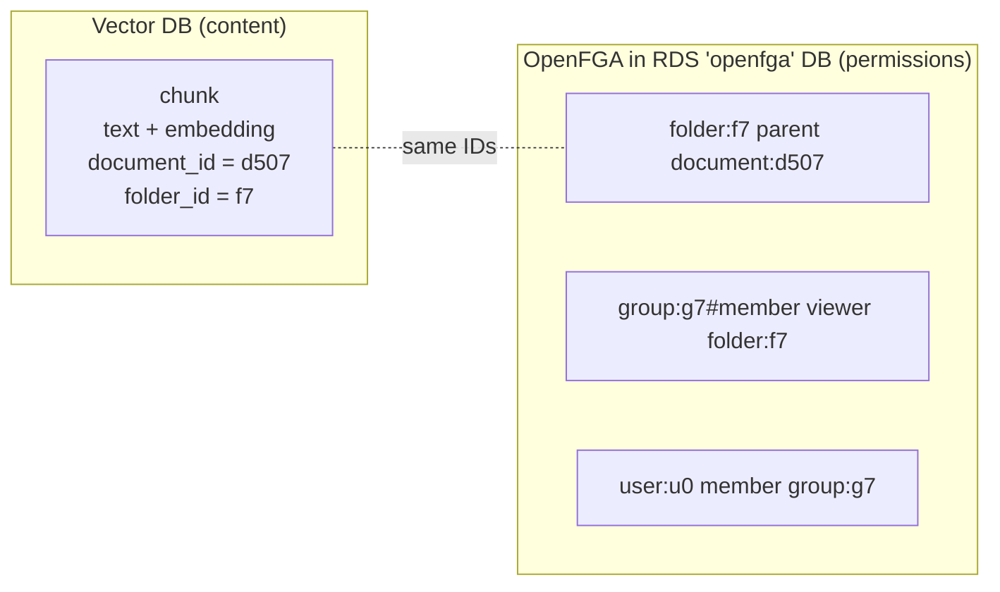

- **Vector DB** = what the document says.
- **OpenFGA** = who may read it.
- They are linked only by **IDs** (`document_id`, `folder_id`).

### 5.2 One chunk in the vector DB

```json
{
  "chunk_id": "d507-c03",
  "embedding": [0.12, -0.03, "..."],
  "text": "Quarterly revenue grew by ...",
  "metadata": {
    "document_id": "d507",
    "folder_id":   "f7",
    "tenant_id":   "tennat",
    "title":       "Q3 Finance Report.pdf",
    "source":      "sharepoint",
    "page":        4,
    "chunk_index": 3,
    "updated_at":  "2026-11-01T10:00:00Z"
  }
}
```

| Field | Required | Why |
|---|---|---|
| `chunk_id` | yes | unique id of the chunk |
| `embedding` | yes | similarity search |
| `text` | yes | sent to the LLM |
| `document_id` | **yes** | check direct shares (`document:d507`) |
| `folder_id` | **yes** | folder check (`folder:f7`) and pre-filter |
| `tenant_id` | optional | hard separation between customers |
| `title`, `source`, `page`, `chunk_index` | optional | citations in the answer |
| `updated_at` | optional | re-indexing |

**Do NOT store** user lists, group lists, or allowed/denied results in the vector DB.
Permissions change often; OpenFGA is the only source of truth.
The `folder_id` field must be **indexed / filterable** in the vector DB (needed for pre-filtering).

### 5.3 Ingestion (document upload)

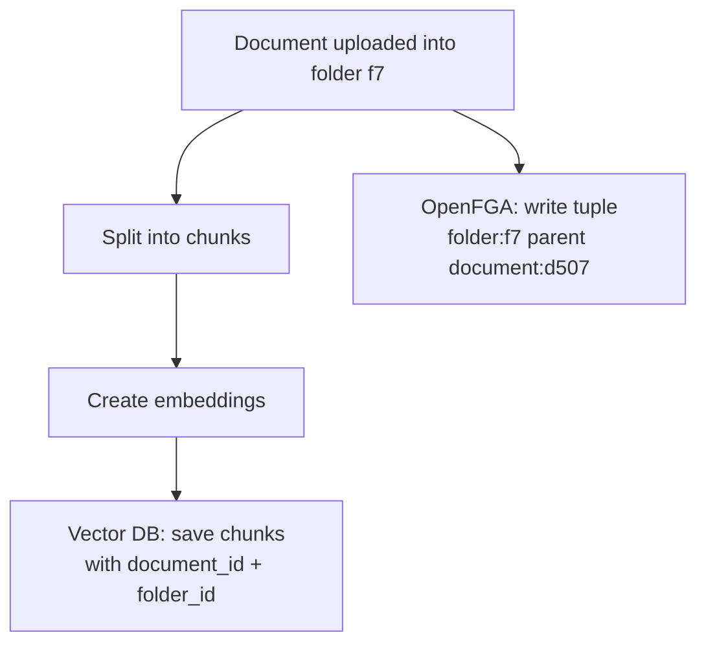

### 5.4 Keeping both in sync

| DocAI event | Vector DB | OpenFGA |
|---|---|---|
| Upload document | add chunks | `folder:F parent document:D` |
| Move document | update `folder_id` on its chunks | delete old parent tuple, add new |
| Delete document | delete chunks | delete its tuples |
| Team gets folder access | - | `group:G#member viewer folder:F` |
| User joins team | - | `user:U member group:G` |
| Share doc with one person | - | `user:U viewer document:D` |
| Remove any access | - | same tuple under `deletes` |

Permission changes touch **only OpenFGA**. Vector DB changes only when content changes or moves.

---

## 6. Retrieve more than you need

The vector DB finds the closest chunks but does not know **who** is asking.
Many of the best matches may be denied.

**Library analogy:** ask for the 10 best books, security lets you keep 2 -> weak answer.
Ask for 100, security lets you keep 20 -> read the best 10 -> good answer.

### 6.1 Bad: retrieve only what you need

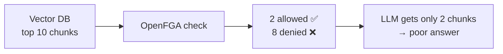

### 6.2 Good: retrieve more, keep the best allowed

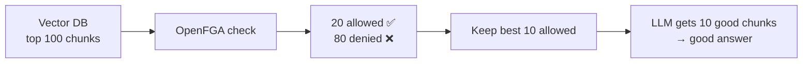

| Step | Number |
|---|---|
| Chunks the LLM needs | 10 |
| Ask the vector DB for | 5-10x more (50-100) |
| After OpenFGA check | keep allowed ones, in search-score order |
| Send to LLM | top 10 allowed |
| Too few allowed (< 5) | fetch the next 100, or reply "not enough accessible information" |

Folder checks make this cheap: 100 chunks from 5 folders cost about the same as 10 chunks.

---

## 7. Post-filtering vs pre-filtering

### 7.1 Post-filtering: search everything, then remove denied

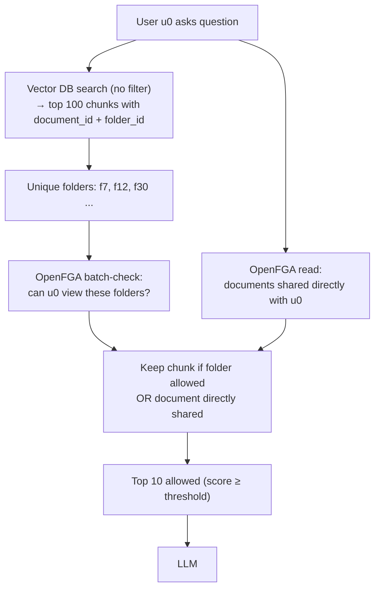

### 7.2 Pre-filtering: ask OpenFGA first, search only allowed content

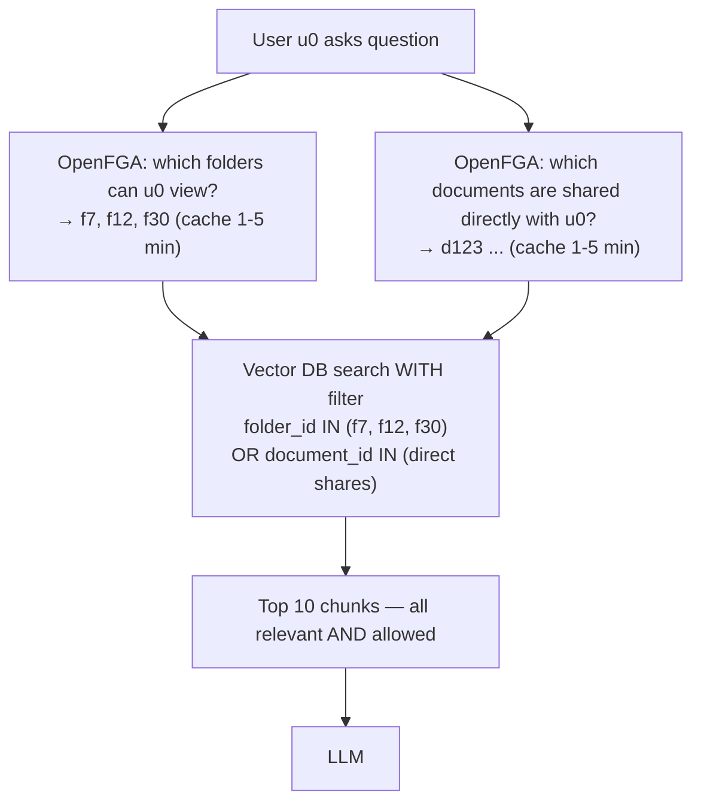

### 7.3 Comparison

| | Post-filtering | Pre-filtering |
|---|---|---|
| Order | search -> check -> drop denied | check -> search only allowed |
| OpenFGA calls per question | 1 batch-check (~5 folders) + 1 read | 1-2 (cacheable per user) |
| Chunks thrown away | many (94% in test) | none |
| Answer quality | good if you retrieve enough | best: top-k are all allowed |
| Vector DB requirement | none | metadata filter on `folder_id` / `document_id` |
| Works best when | user can see a huge number of folders | user can see tens to a few thousand folders |
| Risk | too few allowed chunks -> weak answer | very long filter lists if a user sees everything |

**Recommendation:** pre-filtering for normal users; fall back to post-filtering for users who can see a very large number of folders (e.g. admins).

### 7.4 Pre-filter example (pseudo-code)

```python
folders = fga_list_objects(user, relation="viewer", type="folder")      # cached per user
shared  = fga_read_direct_shares(user, type="document")                 # cached per user
chunks  = vector_db.search(
    query_embedding,
    top_k=20,
    filter={"or": [{"folder_id": {"in": folders}}, {"document_id": {"in": shared}}]},
)
chunks = [c for c in chunks if c.score >= MIN_SCORE]
```

### 7.5 Post-filter example (pseudo-code)

```python
chunks  = vector_db.search(query_embedding, top_k=100)
folders = {c.folder_id for c in chunks}
allowed_folders = fga_batch_check(user, "viewer", [f"folder:{f}" for f in folders])
shared  = fga_read_direct_shares(user, type="document")
chunks  = [c for c in chunks
           if (c.folder_id in allowed_folders or c.document_id in shared) and c.score >= MIN_SCORE][:10]
```

---

## 8. Avoid hallucination

Filtering does not cause hallucination by itself. Hallucination happens when the LLM gets
**weak or no context** and guesses.

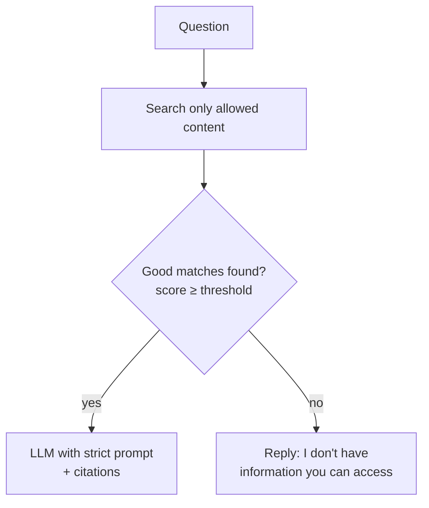

| Rule | Why |
|---|---|
| Minimum similarity score | drop weak matches even if allowed |
| No chunks -> don't call the LLM | no context = guaranteed guessing |
| Prompt: "answer only from the context, otherwise say you don't know" | stops invention |
| Ask for citations (document + page) | user can verify |
| Never send denied chunks to the LLM | LLM could leak them |
| Never say "3 documents were hidden" | leaks that restricted documents exist |

---

## 9. Full end-to-end flow (recommended)

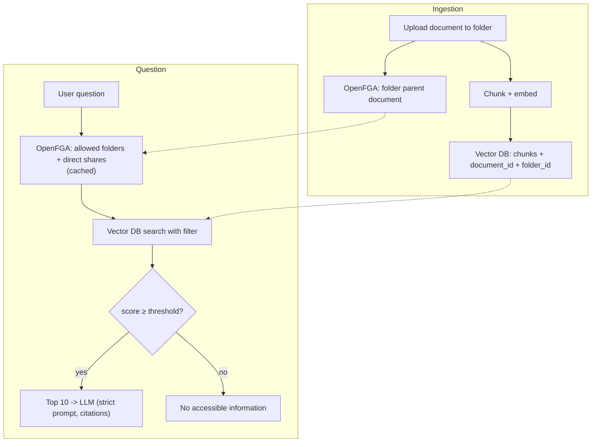
