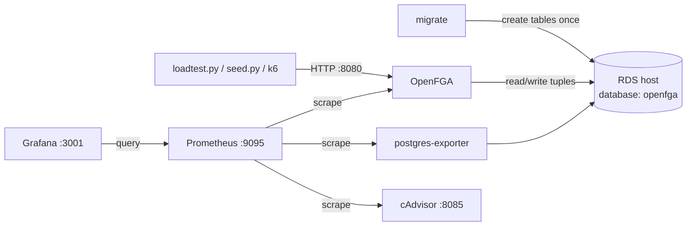
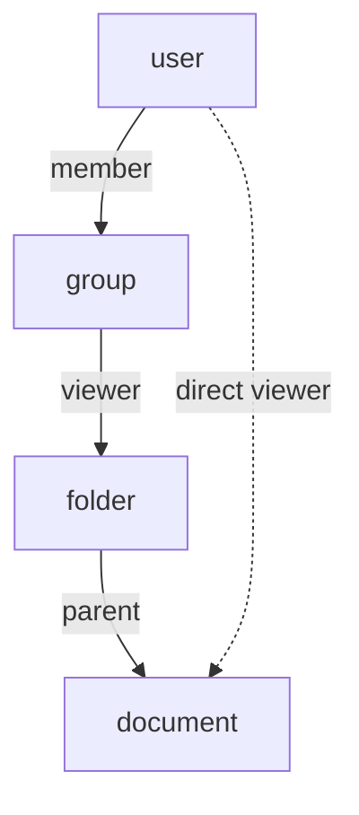
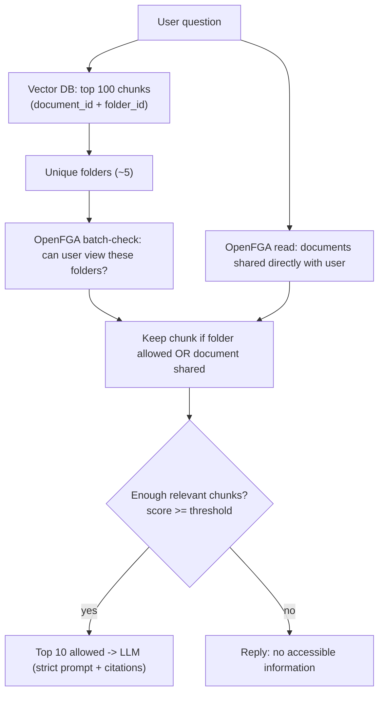

# OpenFGA RAG Capacity Test - Runbook

What we built, how it works, every important command, and what we found.
All diagrams, vector DB storage, and pre/post filtering: see [DIAGRAMS.md](DIAGRAMS.md).

> **Based on Google Zanzibar.** OpenFGA ([github.com/openfga/openfga](https://github.com/openfga/openfga), [docs](https://openfga.dev/docs))
> is an open-source implementation of Google's paper
> [*Zanzibar: Google's Consistent, Global Authorization System*](https://research.google/pubs/zanzibar-googles-consistent-global-authorization-system/) (USENIX ATC 2019).
> Why it is good and how it scales: [DIAGRAMS.md section 0](DIAGRAMS.md#0-background-openfga-and-google-zanzibar).

---

## 1. Goal

DocAI is a RAG app. Before showing document chunks to a user, it must ask
**"Can this user see this document?"**. OpenFGA answers that question.
This lab measures **how many user questions per second one OpenFGA can handle**, and how to make it faster.

---

## 2. Architecture



- **Same RDS host as DocAI**, but a **separate database `openfga`**. The DocAI app database (`postgres`) is never touched.
- Everything runs on the POC machine `10.92.27.60` (4 CPU cores, 15 GB RAM, shared with other users).

---

## 3. Files

| File | Purpose |
|---|---|
| `config.py` | Creates the `openfga` database if missing, checks migrations and OpenFGA health |
| `docker-compose.yml` | OpenFGA, migrate, local Postgres (unused with RDS), Prometheus, Grafana, cAdvisor, exporter |
| `common.py` | OpenFGA URL + authorization model |
| `seed.py` | Writes test data (200k documents) into OpenFGA |
| `loadtest.py` | Simulates RAG user questions and measures speed |
| `loadtest.k6.js` | Same test with k6 (optional) |
| `.env` | Secrets and settings (never commit) |
| `requirements.txt` | Python packages |
| `state.json` | Generated by `seed.py` (store id, model id, sizes) |

---

## 4. Permission model (hierarchy)



A user can view a document if:
- the document is **in a folder** the user's **group** can view, **or**
- the document is **shared directly** with the user.

Every permission is stored as a **tuple**: `<who> <relation> <what>`.

| Tuple example | Meaning | Count in test data |
|---|---|---|
| `folder:f7 parent document:d507` | d507 is in folder f7 | 200,000 |
| `user:u9 viewer document:d123` | d123 shared directly with u9 | ~10,000 |
| `group:g3#member viewer folder:f7` | team g3 can open folder f7 | ~750 |
| `user:u5 member group:g3` | u5 is in team g3 | ~2,000 |

Stored in RDS database `openfga`, table `tuple` (plus `store`, `authorization_model`, `changelog`, `goose_db_version`).

---

## 5. Setup (one time, on the POC machine)

```bash
cd ~/opengfa
python -m venv .venv && source .venv/bin/activate
pip install -r requirements.txt
```

### `.env` settings (names only, values are secret)

| Variable | Meaning |
|---|---|
| `DB_USER`, `DB_PASSWORD` | RDS login used by `config.py` |
| `OPENFGA_DB_NAME` | `openfga` (never `postgres`) |
| `DB_SSLMODE` | `require` |
| `OPENFGA_DATASTORE_URI` | `postgres://<user>:<password>@<rds-host>:5432/openfga?sslmode=require` - makes docker use RDS |
| `JUMP_*` | Only for laptops reaching RDS via jump server. Comment out on the POC machine |
| `PROM_PORT=9095`, `PLAYGROUND_PORT=3005`, `CADVISOR_PORT=8085` | Ports changed because defaults were busy on POC |
| `FGA_CPUS`, `FGA_MEM` | OpenFGA size (we used `3` and `4g`) |
| `FGA_CHECK_CACHE` | `true` = OpenFGA check cache on |
| `FGA_DB_MAX_OPEN_CONNS`, `FGA_DB_MAX_IDLE_CONNS` | DB pool size (default 30/10 is best here) |
| `FGA_REQUEST_TIMEOUT` | Default `3s` |

### Steps

```bash
python config.py          # 1. create 'openfga' DB if missing
docker compose up -d      # 2. migrate tables + start OpenFGA and monitoring
python config.py          # 3. expect: migrations applied, openfga SERVING
python seed.py --concurrency 8   # 4. load test data, expect "failed tuples: 0"
```

### URLs (POC)

| What | URL |
|---|---|
| OpenFGA API | http://10.92.27.60:8080 |
| Playground | http://10.92.27.60:3005 |
| Grafana | http://10.92.27.60:3001 |
| Prometheus | http://10.92.27.60:9095 |
| cAdvisor | http://10.92.27.60:8085 |

---

## 6. Load test commands

```bash
# A) old way: check every document (100 checks per question)
python loadtest.py --requests 1000 --concurrency 15 --query-folders 5

# B) smart way: check each folder once + direct shares once
python loadtest.py --requests 1000 --concurrency 15 --query-folders 5 --mode folder

# find the limit (raise concurrency until p95 is too high or errors appear)
python loadtest.py --requests 3000 --concurrency 30 --query-folders 5 --mode folder

# several test processes in parallel (one Python process = max 1 CPU core)
for i in 1 2; do
  python loadtest.py --requests 3000 --concurrency 20 --query-folders 5 --mode folder --seed $i > run$i.log 2>&1 &
done
wait; grep -h "queries/s\|per query" run*.log
```

| Option | Meaning |
|---|---|
| `--requests N` | total questions in the test |
| `--concurrency N` | how many simulated users ask **at the same time** (each waits for the answer, then asks again) |
| `--candidates N` | chunks returned by the vector DB per question (default 100) |
| `--query-folders N` | chunks come from N folders (realistic RAG). `0` = fully random |
| `--mode batch\|check\|folder` | how access is checked |
| `--seed N` | different random questions per parallel process |

**Reading the output**
- `queries/s` - questions per second handled
- `p50` - typical time per question, `p95` - slow ones (95% are faster than this)
- `errors` / `check errors` - must be 0. Non-zero = overloaded (3 s timeout hit)
- `allowed / denied` - answers. Should be similar between modes

---

## 7. What we did and found

### 7.1 Setup issues fixed
| Problem | Fix |
|---|---|
| `config.py` was the DocAI app config with hardcoded credentials | Rewritten as DB setup/check script, credentials moved to `.env` |
| OpenFGA used the local container DB | `OPENFGA_DATASTORE_URI` in `.env` -> RDS `openfga` DB |
| Port 9090 already in use on POC | Host ports configurable (`PROM_PORT`, etc.) |
| `seed.py`: 16 batches timed out (`deadline_exceeded`) | Retries with backoff + `--concurrency` (default 8). Now `failed tuples: 0` |
| `loadtest.py` hid timeouts inside batch-check as "denied" | Now reports `check errors` |

### 7.2 Tuning experiments (check every document, 100 random docs per question)

| Run | Change | queries/s | p95 | Result |
|---|---|---|---|---|
| Baseline | 2 cores, defaults | 13.8 | 950 ms | slow |
| More DB connections | pool 100 | 8.6 | 3,026 ms | **worse** (reverted) |
| Check cache | `FGA_CHECK_CACHE=true` | 12.8 | 1,098 ms | no real change |
| Go CPU fix | `GOMAXPROCS=2` | 10.8 | 1,269 ms | no change |
| 3 cores | `FGA_CPUS=3` | 16.7 | 1,558 ms | scales with CPU |

- RDS round-trip: **0.37 ms** -> network/database are **not** the problem.
- OpenFGA CPU at **~190% of 200%** -> OpenFGA CPU was the bottleneck.
- Cause: 100 checks per question, 94% denied (denied = most work).

### 7.3 Folder mode (the big win) - same machine, 3 cores, 5 folders per question

| | Check every document | Check by folder | Gain |
|---|---|---|---|
| queries/s | 15.0 | **113.2** | 7.5x |
| p50 | 902 ms | **106 ms** | 8.5x faster |
| p95 | 2,129 ms | **275 ms** | 7.7x faster |
| check errors | 2,920 | **0** | no overload |

### 7.4 Limit search (folder mode)

| Users at once | Questions | queries/s | p50 | p95 | errors |
|---|---|---|---|---|---|
| 15 | 1,000 | 113 | 106 ms | 275 ms | 0 |
| 30 | 3,000 | 114 | 202 ms | 632 ms | 0 |
| 30 | 5,000 | 109 | 217 ms | 644 ms | 0 |

During the 30-user run: **Python load test 100% CPU**, **OpenFGA only 66% of 300%**.
-> ~110 q/s is the limit of the **test script**, not OpenFGA. OpenFGA has more room.
Next: run parallel test processes or test from another machine.

---

## 8. Recommended design for DocAI

### 8.1 Check by folder, not by document



Valid only while the rule is "document viewer = direct share OR folder viewer". Change the logic if the model changes.

### 8.2 Even better: filter before searching
Ask OpenFGA once which folders the user can see (cache 1-5 min), then search the vector DB **only inside those folders** (`folder_id IN (...)`). All returned chunks are allowed and relevant.

### 8.3 What to store in the vector DB (per chunk)

```json
{
  "chunk_id": "d507-c03",
  "embedding": [0.12, -0.03],
  "text": "...",
  "metadata": { "document_id": "d507", "folder_id": "f7", "tenant_id": "...", "title": "...", "page": 4 }
}
```

- Store **IDs only** (`document_id`, `folder_id`), same IDs as in OpenFGA.
- **Never** store user/group permission lists in the vector DB. OpenFGA is the only source of truth.

### 8.4 Keep both in sync

| DocAI event | Vector DB | OpenFGA |
|---|---|---|
| Upload document | add chunks | `folder:F parent document:D` |
| Move document | update `folder_id` | delete old parent tuple, add new |
| Delete document | delete chunks | delete its tuples |
| Team gets folder access | - | `group:G#member viewer folder:F` |
| User joins team | - | `user:U member group:G` |
| Share doc with one person | - | `user:U viewer document:D` |

### 8.5 Avoid hallucination
- Retrieve more (e.g. 100), keep top 10-20 **allowed** chunks.
- Use a minimum similarity score.
- No allowed chunks -> do not call the LLM, say "no accessible information".
- Prompt: "Answer only from the context; otherwise say you don't know." Ask for citations.
- Never send denied chunks to the LLM, never reveal hidden documents exist.

---

## 9. Docker basics

| Command | Meaning |
|---|---|
| `docker compose up -d` | start/update all containers in background |
| `docker compose up -d openfga` | recreate only OpenFGA (after `.env` change) |
| `docker compose up -d --force-recreate openfga` | force recreate |
| `docker compose down` | stop + remove containers (volumes kept) |
| `docker compose down -v` | also delete local volumes (not RDS) |
| `docker compose ps` | list containers |
| `docker compose logs migrate` | logs of a service (`-f` to follow) |
| `docker compose config --quiet && echo OK` | validate compose file |
| `docker stats fga-openfga --no-stream` | CPU / memory of OpenFGA |
| `docker inspect fga-openfga --format '{{range .Config.Env}}{{println .}}{{end}}'` | env settings inside OpenFGA |

Ports: `"HOST:CONTAINER"` - left side is the POC machine port, right side is inside the container.

---

## 10. Useful checks

```bash
# OpenFGA health
curl localhost:8080/healthz

# which ports are busy
ss -ltn | grep -E ':(8080|3001|3005|8085|9095)\b'

# RDS round-trip latency
python -c "import time,config as c;cn=c._connect(c.OPENFGA_DB_NAME);cur=cn.cursor();t=time.perf_counter();[cur.execute('select 1') for _ in range(50)];print((time.perf_counter()-t)/50*1000,'ms')"

# tuples per type
python -c "import config as c;cn=c._connect(c.OPENFGA_DB_NAME);cur=cn.cursor();cur.execute('select object_type,relation,split_part(_user,chr(58),1),count(*) from tuple group by 1,2,3 order by 1,2');[print(r) for r in cur.fetchall()]"

# what the DB is waiting on (run during a load test)
python -c "import config as c;cn=c._connect(c.OPENFGA_DB_NAME);cur=cn.cursor();cur.execute(\"select state,wait_event_type,wait_event,count(*) from pg_stat_activity where datname='openfga' group by 1,2,3 order by 4 desc\");[print(r) for r in cur.fetchall()]"

# CPU of OpenFGA and the test script during a run
docker stats fga-openfga --no-stream
top -bn1 | grep python

# remove one line from .env
sed -i '/^FGA_CHECK_CACHE=/d' .env

# nano: save = Ctrl+O, Enter   exit = Ctrl+X
```

---

## 11. Troubleshooting

| Symptom | Cause / fix |
|---|---|
| `port is already allocated` | Set another port in `.env` (`PROM_PORT`, etc.) |
| `migrations: NOT applied` after `up -d` | `OPENFGA_DATASTORE_URI` not set -> uncomment in `.env`, `docker compose up -d --force-recreate` |
| `deadline_exceeded` in seed/load test | Overloaded: lower `--concurrency`, or more `FGA_CPUS`, or `FGA_REQUEST_TIMEOUT=10s` |
| `docker exec ... env` prints nothing | OpenFGA image has no shell tools, use `docker inspect` |
| Python test at 100% CPU | Test script is the limit: run several with `--seed`, or from another machine |
| Grafana Postgres panels look wrong | They show the local container, use RDS CloudWatch for the real DB |

---

## 12. Next steps

1. Measure OpenFGA's real limit with parallel test processes or from another machine.
2. Repeat with `FGA_CPUS=2` to get a per-core number for production sizing.
3. Test `--query-folders 20` (results spread over more folders).
4. Agree with the DocAI team what "folder" means (SharePoint site, shared folder, email folder, project...).
5. Add `folder_id` to vector DB chunk metadata and implement folder-level checks in DocAI.
6. Optional: measure the "filter before search" approach (`--mode prefilter`).

## 13. Security reminders
- Credentials only in `.env`. Never commit `.env`. Rotate the DB password that used to be hardcoded in `config.py`.
- Grafana runs with anonymous admin: do not expose it outside the network.
- Never use the DocAI `postgres` database for OpenFGA.
